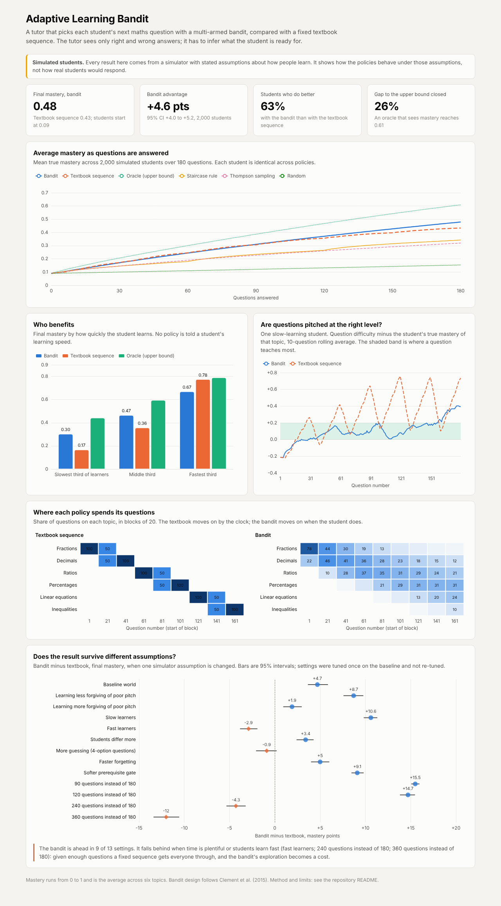

# Adaptive Learning Bandit

A tutor that chooses each student's next maths question with a multi-armed bandit, tested against a fixed textbook sequence on simulated students. The tutor sees only right and wrong answers.

**Live dashboard:** https://satwik-kotta.github.io/adaptive-learning-bandit/



> **Everything here is simulation.** The students are a model with stated assumptions about how learning works. The results show how the policies behave under those assumptions. They are not evidence about real students.

## What it found

2,000 simulated students, 180 questions each, six topics. Mastery runs from 0 to 1; students start at 0.09.

| Policy | Final mastery | vs textbook | Post-test score |
|---|---|---|---|
| Oracle (sees true mastery; upper bound) | 0.61 | +17.6 pts | 62% |
| **Learning-progress bandit** | **0.48** | **+4.6 pts** (95% CI +4.0 to +5.2) | 52% |
| Textbook sequence (linear curriculum) | 0.43 | | 50% |
| Staircase rule | 0.34 | −9.0 pts | 44% |
| Thompson sampling toward a target success rate | 0.32 | −11.4 pts | 42% |
| Random questions | 0.15 | −27.9 pts | 30% |

The bandit beats the textbook sequence, but modestly: it closes 26% of the gap to the oracle, and 63% of students do better with it.

The average hides who gains and who loses:

| Learner speed | Bandit | Textbook |
|---|---|---|
| Slowest third | 0.30 | 0.17 |
| Middle third | 0.47 | 0.36 |
| Fastest third | 0.67 | 0.78 |

The textbook moves on by the clock, so slow learners are pushed into topics whose prerequisites they have not learned. The bandit waits for them. Fast learners do not need the wait, and the bandit's exploration costs them.

**Robustness.** With settings frozen, the bandit stays ahead in 9 of 13 altered simulators. It loses when learners are fast (−2.9 pts) and when there is plenty of time (−4.3 pts at 240 questions, −12 pts at 360); with more guessing the two are level. With little time it wins by more (+15.5 pts at 90 questions).

**Untuned, the bandit lost.** With default settings it scored 0.38 against the textbook's 0.43. Settings were then tuned on a separate set of 250 students and evaluated on fresh ones.

## How it works

**Arms.** 30 of them: six topics by five difficulty levels.

**Reward.** The tutor cannot observe learning, so it rewards an arm when the student's recent success rate on that arm is changing. An arm the student always gets right or always gets wrong shows no progress and fades out.

**Selection.** Arms are sampled in proportion to smoothed learning progress, with some uniform exploration (EXP3 style). Only arms in the current zone of proximal development are eligible: a harder level or the next topic opens once the student succeeds on the one before, and mastered arms close. The design follows Clement et al. (2015), *Multi-Armed Bandits for Intelligent Tutoring Systems*.

**Simulator** (`src/student.py`), each assumption a parameter:

- Probability of a correct answer rises with mastery minus difficulty, with guessing and slips.
- A question teaches most when pitched slightly above current mastery.
- Each topic needs the previous one mostly mastered.
- Unpractised topics decay slowly.
- Students differ in starting knowledge and learning speed.

**Comparisons.** Every policy meets the identical student for a given seed, so differences are paired. Intervals are bootstrapped across students.

## Limits

- The simulator's learning rule (best gains just above current mastery) is the same idea the bandit is built to exploit. A real classroom may not behave that way.
- The textbook baseline is a simple equal-time sequence. Real curricula include review and teacher judgement.
- Bandit settings were tuned by random search over 40 configurations in the baseline simulator only.
- The objective is average mastery across topics. A different objective, such as minimum competence in every topic, could reorder the policies.

## Run it

```bash
pip install -r requirements.txt
make all      # tune on development students (3 min), evaluate on fresh ones (3 min)
make test
open docs/index.html
```

## Layout

```
src/student.py     simulated student
src/policies.py    textbook, random, staircase, Thompson, learning-progress bandit, oracle
src/tune.py        settings search on development students
src/evaluate.py    main comparison, robustness sweep, dashboard data
tests/             simulator and policy checks
artifacts/         tuned_params.json, results.json
docs/              dashboard
```
